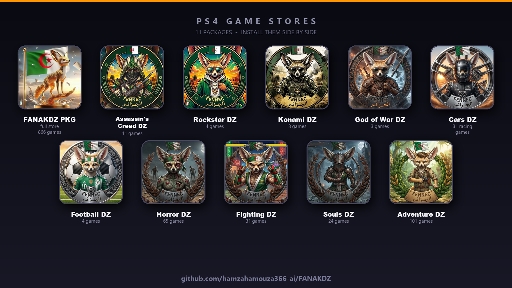

# متجر FANAKDZ للـ PlayStation 4

إحدى عشرة حزمة (fake PKG) لتشغيل مكتبة ألعاب على PS4 مكسور الحماية: تتصفّح الألعاب
بالصور، ثم تنزّل وتثبّت اللعبة مباشرة من الجهاز — **بدون حاسوب**.

---

## 📦 الحزم الإحدى عشرة

| الحزمة | المعرّف | الوصف |
|---|---|---|
| `IV0000-FANK00001_00-FANAKDZPKG000000.pkg` | FANK00001 | **FANAKDZ PKG** — المتجر الكامل بكل الألعاب |
| `IV0000-FANK00002_00-ASSASSINSCREEDZ0.pkg` | FANK00002 | **Assassin's Creed DZ** — ألعاب Assassin's Creed فقط |
| `IV0000-FANK00003_00-ROCKSTARDZ000000.pkg` | FANK00003 | **Rockstar DZ** — ألعاب Rockstar فقط |
| `IV0000-FANK00004_00-KONAMIDZ00000000.pkg` | FANK00004 | **Konami DZ** — ألعاب Konami فقط |
| `IV0000-FANK00005_00-GODOFWARDZ000000.pkg` | FANK00005 | **God of War DZ** — ألعاب God of War فقط |
| `IV0000-FANK00006_00-CARSDZ0000000000.pkg` | FANK00006 | **Cars DZ** — كل ألعاب السيارات والسباق |
| `IV0000-FANK00007_00-FOOTBALLDZ000000.pkg` | FANK00007 | **Football DZ** — كل ألعاب كرة القدم |
| `IV0000-FANK00008_00-HORRORDZ00000000.pkg` | FANK00008 | **Horror DZ** — كل ألعاب الرعب |
| `IV0000-FANK00009_00-FIGHTINGDZ000000.pkg` | FANK00009 | **Fighting DZ** — كل ألعاب القتال |
| `IV0000-FANK00010_00-SOULSDZ000000000.pkg` | FANK00010 | **Souls DZ** — كل ألعاب السولز (Souls-like) |
| `IV0000-FANK00011_00-ADVENTUREDZ00000.pkg` | FANK00011 | **Adventure DZ** — كل ألعاب المغامرات |

الحزم **تطبيقات مستقلّة**: تُثبَّت معًا ولا تمحو إحداها الأخرى، ولكل واحدة
أيقونتها وصورتها الخاصة في مكتبة الجهاز. تطبيقات الرفوف
(**Assassin's Creed DZ** · **Rockstar DZ** · **Konami DZ** · **God of War DZ**
· **Cars DZ** · **Football DZ** · **Horror DZ** · **Fighting DZ** · **Souls DZ**
· **Adventure DZ**)
تعرض ألعابها فقط بمجرد الفتح ولا تحتاج أي إعداد، بينما **FANAKDZ PKG** يعرض
المكتبة كاملة.

الألعاب التي يعرضها كل تطبيق مأخوذة من المكتبة نفسها (866 لعبة):

| التطبيق | الألعاب |
|---|---|
| FANAKDZ PKG | المكتبة كاملة (866 لعبة) |
| Assassin's Creed DZ | Chronicles Trilogy · III · IV Black Flag · Mirage · Odyssey · Origins · Rogue · Syndicate · The Ezio Collection · Unity · Valhalla |
| Rockstar DZ | Grand Theft Auto V · Red Dead Redemption · Red Dead Redemption 2 · L.A. Noire |
| Konami DZ | METAL GEAR SOLID · METAL GEAR SOLID 2: Sons of Liberty · METAL GEAR SOLID 3: Snake Eater · METAL GEAR SOLID V · SUPER BOMBERMAN R 2 · ZONE OF THE ENDERS: The 2nd Runner M∀RS · PES 2025 · eFootball |
| God of War DZ | God of War · God of War Ragnarök · God of War III |
| Cars DZ | **31 لعبة سباق / قيادة** (918 غيغا): Need for Speed Heat · Payback · Rivals · Gran Turismo 7 (US/EU) · Gran Turismo SPORT · Assetto Corsa · Competizione · DIRT 5 · DiRT Rally · DiRT Rally 2.0 · GRID Legends · The Crew 2 · Trackmania Turbo · Wreckfest · Burnout Paradise · DRIVECLUB · HOT WHEELS UNLEASHED 2 · ONRUSH · Crash Team Racing · Mantis Burn Racing · Neon Drive · SnowRunner · MudRunner · Expeditions: A Mudrunner Game · Ride 4 · MotoGP 24 · MX vs ATV Legends · Monster Energy Supercross 6 · Trials Fusion · Trials Rising |
| Football DZ | **4 ألعاب كرة قدم** (200 غيغا): EA SPORTS FC 24 · EA SPORTS FC 26 · PES 2025 · eFootball |
| Horror DZ | **65 لعبة رعب** (952 غيغا): Resident Evil (11) · Outlast (2) · The Evil Within (2) · Amnesia (3) · Layers of Fear (2) · Little Nightmares (3) · Five Nights at Freddy's (6) · Bendy (2) · Dead Rising (4) · Dead Island (3) · Dying Light (2) · Zombie Army (2) · Hello Neighbor (3) · The Dark Pictures Anthology (4) · Alien: Isolation · Until Dawn · The Quarry · The Callisto Protocol · Blair Witch · Visage · SOMA · Observer · Carrion · Darkwood · The Forest · Chernobylite · Deadlight · DAYS GONE · The Walking Dead · Fear The Spotlight |
| Fighting DZ | **31 لعبة قتال** (662 غيغا): Tekken 7 · Street Fighter IV · V · 6 · Collection · Mortal Kombat X · 11 · Injustice 2 · Dragon Ball FighterZ · XENOVERSE 1 · 2 · Guilty Gear -Strive- · MARVEL VS. CAPCOM: INFINITE · MARVEL vs. CAPCOM Fighting Collection · Naruto Ultimate Ninja STORM (4 · 4 Road to Boruto · Trilogy · Connections) · JUMP FORCE · JoJo's Bizarre Adventure (All-Star Battle R · Eyes of Heaven) · Brawlhalla · Persona 4 Arena · Stick Fight · Fight'N Rage · Streets of Rage 4 · SIFU · TMNT: Shredder's Revenge · EA SPORTS UFC 4 · WWE 2K24 · WWE 2K Battlegrounds |
| Souls DZ | **24 لعبة سولز** (419 غيغا): Dark Souls · Dark Souls II · Dark Souls III · Bloodborne · Elden Ring · Elden Ring Nightreign · Sekiro: Shadows Die Twice · Nioh · Nioh 2 · The Surge · The Surge 2 · Mortal Shell · Ashen · Code Vein · Lies of P · Darksiders III · Star Wars Jedi: Fallen Order · Star Wars Jedi: Survivor · Hollow Knight · Hollow Knight: Silksong · Blasphemous · Blasphemous 2 · Eldest Souls · Nine Sols |
| Adventure DZ | **115 لعبة مغامرات** (1854 غيغا): Uncharted (3) · Tomb Raider (5) · Lara Croft (2) · Arkham (3) · Spider-Man (3) · Horizon Zero Dawn · Horizon Forbidden West · Concrete Genie · Gravity Rush (2) · Tearaway · Middle-earth (2) · Darksiders (4) · Prince Of Persia · A Plague Tale · Guardians of the Galaxy (2) · Hellblade · Death Stranding · Ghost of Tsushima · The Last of Us (2) · Control · It Takes Two · A Way Out · Kena · Stray · Tunic · Ratchet · Sackboy · Knack (2) · Shadow of the Colossus · The Last Guardian · inFAMOUS (2) · The Order: 1886 · MediEvil · Valiant Hearts (2) · Life Is Strange (4) · Detroit · Heavy Rain · Beyond: Two Souls · Wolf Among Us · Telltale (2) · Tales from the Borderlands (2) · Until Dawn · The Quarry · The Dark Pictures (4) · Twelve Minutes · Telling Lies · The Awesome Adventures of Captain Spirit · Night in the Woods · Zero Escape · Day of the Tentacle · Grim Fandango · Thimbleweed · Little Big Adventure · Outer Wilds · Subnautica (2) · No Man's Sky · Firewatch · What Remains of Edith Finch · Ethan Carter · Oxenfree (2) · Journey (3) · LIMBO · Unravel (2) · ABZU · RiME · Gone Home · Everybody's Gone · The Pathless · Spiritfarer · GRIS · Sea of Solitude · The Artful Escape · Call Of The Sea · Return of the Obra Dinn · A Short Hike · The Forgotten City · INSIDE · Planet of Lana · The Last Campfire · The Sexy Brutale · Time on Frog Island |

> **Football DZ** يخصّ كرة القدم (Soccer)؛ **Madden NFL 24** (كرة القدم
> الأمريكية) غير مشمولة. و**Horror DZ** و**Fighting DZ** و**Souls DZ** و
> **Adventure DZ** تعتمد على الأسماء لأن المكتبة لا تحمل حقل التصنيف؛ أخبرني لو
> أردت إضافة/إزالة عنوان.

---

## ✅ المتطلبات

* PS4 مكسور الحماية (GoldHEN أو أي HEN يعمل).
* اتصال بالإنترنت على الجهاز (Wi‑Fi أو كابل).
* مساحة كافية في `/data` (اللعبة الواحدة قد تصل إلى 114 غيغا، والتثبيت يستهلك
  الضعف مؤقتًا: التنزيل + التثبيت).

---

## 🛠️ طريقة التثبيت

### الطريقة 1 — عبر FTP ثم مُثبِّت الحزم (الأسهل)

**1) انسخ الملف إلى الجهاز**

عن طريق **FileZilla**:

| الحقل | القيمة |
|---|---|
| Host | `192.168.x.x` ‏(عنوان جهازك) |
| Port | `2121` |
| User | `anonymous` |
| Password | (اتركه فارغًا) |

ثم اسحب الملف إلى المجلد `/data/pkg/`.

أو بالأمر مباشرة (Windows / Linux / macOS):

```bash
curl -T IV0000-FANK00001_00-FANAKDZPKG000000.pkg  ftp://192.168.x.x:2121/data/pkg/
curl -T IV0000-FANK00002_00-ASSASSINSCREEDZ0.pkg  ftp://192.168.x.x:2121/data/pkg/
curl -T IV0000-FANK00003_00-ROCKSTARDZ000000.pkg  ftp://192.168.x.x:2121/data/pkg/
curl -T IV0000-FANK00004_00-KONAMIDZ00000000.pkg  ftp://192.168.x.x:2121/data/pkg/
curl -T IV0000-FANK00005_00-GODOFWARDZ000000.pkg  ftp://192.168.x.x:2121/data/pkg/
curl -T IV0000-FANK00006_00-CARSDZ0000000000.pkg  ftp://192.168.x.x:2121/data/pkg/
curl -T IV0000-FANK00007_00-FOOTBALLDZ000000.pkg  ftp://192.168.x.x:2121/data/pkg/
curl -T IV0000-FANK00008_00-HORRORDZ00000000.pkg  ftp://192.168.x.x:2121/data/pkg/
curl -T IV0000-FANK00009_00-FIGHTINGDZ000000.pkg  ftp://192.168.x.x:2121/data/pkg/
curl -T IV0000-FANK00010_00-SOULSDZ000000000.pkg  ftp://192.168.x.x:2121/data/pkg/
curl -T IV0000-FANK00011_00-ADVENTUREDZ00000.pkg  ftp://192.168.x.x:2121/data/pkg/
```

**2) ثبّت من الجهاز**

* افتح **GoldHEN** ← **Package Installer**، أو
  **Settings ← Debug Settings ← Game ← Package Installer**.
* اختر الملف من `/data/pkg` واضغط **Install**.
* انتظر انتهاء التثبيت، ثم ستجد التطبيق في الشاشة الرئيسية.

### الطريقة 2 — عبر فلاش USB (بدون شبكة)

1. ضع ملف `.pkg` في **جذر** فلاش USB مهيّأ بصيغة `FAT32` أو `exFAT`.
2. أشبك الفلاش في الجهاز.
3. **Package Installer** ← اختر **USB** ← حدّد الملف ← **Install**.

---

## 🎮 طريقة الاستخدام

افتح التطبيق: تظهر صورة البداية، ثم شبكة الألعاب بالصور.

| الزر | الوظيفة |
|---|---|
| **X** | تنزيل اللعبة المحدّدة وتثبيتها |
| **O (Circle)** | إلغاء / رجوع / خروج |
| **△ (Triangle)** | تسجيل الدخول إلى archive.org (للألعاب التي تحتاج حسابًا) |
| **الاتجاهات / العصا** | التنقّل بين الألعاب |
| **L1 / R1** | الصفحة التالية / السابقة |
| **L2 / R2** | قفزة كبيرة داخل القائمة |

عند اختيار **X** يظهر شريط التقدّم (نسبة التنزيل والسرعة)، وعند الانتهاء يبدأ
التثبيت تلقائيًا. لا تُغلق التطبيق أثناء التنزيل.

---

## 📁 المسارات المهمّة

| المسار | الوظيفة |
|---|---|
| `/data/pkg` | التنزيلات وملفات `.pkg` الجاهزة |
| `/data/fanakdz.log` | سجل التطبيق (يُقرأ عبر FTP عند أي مشكلة) |
| `/data/fanakdz_cookie.txt` | جلسة تسجيل الدخول إلى archive.org |
| `/data/fanakdz_store.txt` | كلمات رفّ FANAKDZ / Assassin's Creed (كلمة في كل سطر) |
| `/data/rockstar_store.txt` | كلمات رفّ Rockstar (اختياري — للتعديل فقط) |
| `/data/konami_store.txt` | كلمات رفّ Konami (اختياري — للتعديل فقط) |
| `/data/godofwar_store.txt` | كلمات رفّ God of War (اختياري — للتعديل فقط) |
| `/data/cars_store.txt` | كلمات رفّ السيارات (اختياري — للتعديل فقط) |
| `/data/football_store.txt` | كلمات رفّ كرة القدم (اختياري — للتعديل فقط) |
| `/data/horror_store.txt` | كلمات رفّ الرعب (اختياري — للتعديل فقط) |
| `/data/fighting_store.txt` | كلمات رفّ القتال (اختياري — للتعديل فقط) |
| `/data/souls_store.txt` | كلمات رفّ السولز (اختياري — للتعديل فقط) |
| `/data/adventure_store.txt` | كلمات رفّ المغامرات (اختياري — للتعديل فقط) |

> تطبيقات الرفوف تعمل **بدون** أي ملف إعداد: قائمة ألعابها مدمجة داخل التطبيق.
> الملفات أعلاه للتخصيص فقط إن أردت تغيير الرفّ.

---

## ❓ مشاكل شائعة

| المشكلة | الحل |
|---|---|
| **لا تظهر أي لعبة** | تأكّد من اتصال الجهاز بالإنترنت، ثم أعد فتح التطبيق |
| **التطبيق يتوقف عند الفتح** | افتح `/data/fanakdz.log` وأرسله؛ غالبًا سببها الشبكة |
| **التنزيل يتوقف في المنتصف** | أعد المحاولة؛ التنزيل يستأنف من حيث توقّف |
| **لا يظهر التطبيق في المكتبة** | أعد تشغيل الجهاز بعد التثبيت |
| **اللعبة تُنزَّل ببطء** | السرعة تعتمد على سيرفر الأرشيف؛ جرّب وقتًا آخر |

---

## 🔧 ملاحظات تقنية

* التطبيقات تعتمد على مكتبة عامة من موقع archive.org، وتُخزِّن قائمة الألعاب
  محليًّا لتعمل بسرعة عند كل فتح.
* التثبيت يستخدم خدمة **BGFT** الرسمية في النظام (نفس طريقة الألعاب العادية).
* التنزيل مُقسَّم إلى عدّة أقسام متوازية لتسريع التحميل، ويستأنف بعد الانقطاع.
* التطبيقات الإحدى عشرة تُبنى من مصدر واحد، وكل تطبيق نسخة مستقلة بمعرّف خاص
  (`FANK00001` … `FANK00011`).

---

## English

Eleven PlayStation 4 homebrew packages (fake PKG) — no PC needed.

| File | Title ID | Description |
|---|---|---|
| `IV0000-FANK00001_00-FANAKDZPKG000000.pkg` | FANK00001 | **FANAKDZ PKG** — the full game store |
| `IV0000-FANK00002_00-ASSASSINSCREEDZ0.pkg` | FANK00002 | **Assassin's Creed DZ** — Assassin's Creed games only |
| `IV0000-FANK00003_00-ROCKSTARDZ000000.pkg` | FANK00003 | **Rockstar DZ** — Rockstar games only |
| `IV0000-FANK00004_00-KONAMIDZ00000000.pkg` | FANK00004 | **Konami DZ** — Konami games only |
| `IV0000-FANK00005_00-GODOFWARDZ000000.pkg` | FANK00005 | **God of War DZ** — God of War games only |
| `IV0000-FANK00006_00-CARSDZ0000000000.pkg` | FANK00006 | **Cars DZ** — every racing / driving game |
| `IV0000-FANK00007_00-FOOTBALLDZ000000.pkg` | FANK00007 | **Football DZ** — every football (soccer) game |
| `IV0000-FANK00008_00-HORRORDZ00000000.pkg` | FANK00008 | **Horror DZ** — every horror game |
| `IV0000-FANK00009_00-FIGHTINGDZ000000.pkg` | FANK00009 | **Fighting DZ** — every fighting game |
| `IV0000-FANK00010_00-SOULSDZ000000000.pkg` | FANK00010 | **Souls DZ** — every souls-like game |
| `IV0000-FANK00011_00-ADVENTUREDZ00000.pkg` | FANK00011 | **Adventure DZ** — every adventure game (115 titles) |

The shelf builds show their own games as soon as they open, no setup at all;
the full store shows the whole library. All eleven can be installed side by side.

**Install**

1. Copy the `.pkg` to the console, e.g. over FTP to `/data/pkg`
   (`curl -T file.pkg ftp://<console-ip>:2121/data/pkg/`), or put it on a
   FAT32/exFAT USB stick.
2. On the console open **GoldHEN → Package Installer**, pick the file and
   press **Install**.

**Controls** — `X` download & install, `O` cancel, `△` sign in to
archive.org, `L1/R1` page, `L2/R2` jump. Downloads land in `/data/pkg`.
